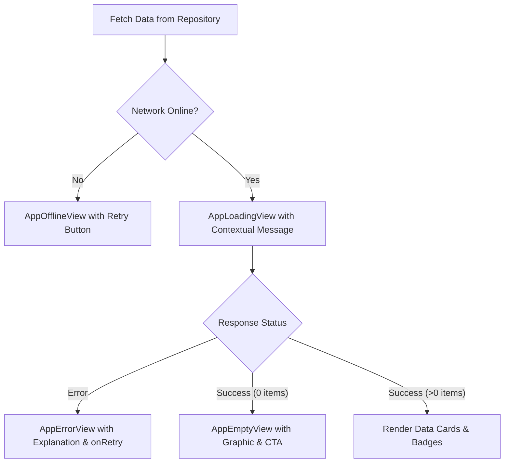

# 🎨 ShramSetu Design System & Component Rules

This document specifies the sovereign visual design system, color palette, and component engineering rules for the **ShramSetu** marketplace application.

---

## 1. 🌈 Color Palette

| Token Role | Name | Hex / Code | Contrast on Soft White | Usage |
| :--- | :--- | :--- | :--- | :--- |
| **Primary Actions** | Deep Teal | `#0B4F55` | **7.4:1 (WCAG AAA)** | Primary CTA buttons, active selection bars, floating actions, interactive indicators |
| **Page Background** | Soft White | `#F8F9FA` | — | Clean, low-glare canvas across all pages, cards, and modal bodies |
| **Highlights** | Warm Amber | `#D97706` | **4.9:1 (WCAG AA)** | Highlights, rating stars, alert badges, pending actions, and offline warnings |
| **Success States** | Green | `#16A34A` | **4.7:1 (WCAG AA)** | Verified artisans, completed orders, escrow payment released, active duty status |

### Supporting Sovereign Neutrals
- **Text Primary:** `#001026` (Deep Sovereign Navy / India Ink, contrast > 15:1)
- **Text Secondary / Subtitles:** `#44474E` (`onSurfaceVariant`)
- **Subtle Borders:** `#C4C6CF` (`outlineVariant`, 1px solid)
- **Surface Elevation:** `#FFFFFF` (`surfaceContainerLowest`, cards and sheets)
- **Error State:** `#BA1A1A` (`error`) with `#FFDAD6` (`errorContainer`)

---

## 2. 📐 Spacing Scale & Typography

### Consistent Spacing Tokens (`AppSpacing`)
```dart
AppSpacing.spacing4xs = 2.0;   // Micro padding
AppSpacing.spacing3xs = 4.0;   // Icon-to-text gap
AppSpacing.spacing2xs = 6.0;   // Compact badge gap
AppSpacing.spacingXs  = 8.0;   // Standard intra-component gap
AppSpacing.spacingSm  = 12.0;  // Card interior elements
AppSpacing.spacingMd  = 16.0;  // Standard screen margins & card padding
AppSpacing.spacingLg  = 20.0;  // Section headers
AppSpacing.spacingXl  = 24.0;  // Major section gutters
AppSpacing.spacing2xl = 32.0;  // Desktop gutters
AppSpacing.touchTargetMin = 48.0; // Minimum interactive touch target
```

### Rounded Cards & Subtle Borders (`AppCard` / `AppRadius`)
- **Card Corners:** `AppRadius.radiusXl` (`16.0px` border radius).
- **Card Borders:** `Border.all(color: AppColors.outlineVariant, width: 1.0)`.
- **Card Elevation:** `0` (flat sovereign craft) with subtle ambient shadow (`color: black.withValues(alpha: 0.03), blurRadius: 6, offset: (0, 2)`).
- **Touchable Surface:** Every card uses `InkWell` or `GestureDetector` with minimum 48px touch clearance.

### Typography Hierarchy (`AppTypography`)
- **Display & Headlines:** `Plus Jakarta Sans` (Display: 36px, Headline Lg: 28px, Headline Md: 20px, Headline Sm: 18px).
- **Body & Labels:** `Inter` (Body Lg: 16px, Body Md: 14px, Body Sm: 13px, Label Lg: 14px bold, Label Sm: 11px bold).
- **Currency & Escrow:** `Plus Jakarta Sans` (24px bold) paired with sovereign ₹ currency glyph.

---

## 3. 🏷️ Accessible Booking Status Badges

> [!IMPORTANT]
> **Component Rule:** Never rely on color alone to convey booking status.

Every status badge in ShramSetu uses the dedicated **`BookingStatusBadge`** component:
```dart
BookingStatusBadge(status: BookingStatus.onTheWay)
// or from database string:
BookingStatusBadge.fromString(booking['status'])
```

### Accessibility Features of `BookingStatusBadge`:
1. **Dedicated Distinct Icon per Status:**
   - `Pending`: Clock icon (`Icons.schedule_rounded`)
   - `Accepted`: Checkmark ring (`Icons.check_circle_outline_rounded`)
   - `On the way`: Navigation arrow (`Icons.near_me_rounded`)
   - `Arrived`: Map pin (`Icons.location_on_rounded`)
   - `In progress`: Wrench / tool gear (`Icons.build_circle_rounded`)
   - `Completed`: Shield verification badge (`Icons.verified_rounded`)
   - `Rejected`: Cross (`Icons.highlight_off_rounded`)
   - `Cancelled`: Ban / slash (`Icons.cancel_outlined`)
2. **Explicit Localized Text Label:** Localized into English, Marathi, and Hindi via `AppStrings.tr()`.
3. **Subtle High-Contrast Border:** Enclosed in `Border.all(color: statusBorder, width: 1.0)`.
4. **Screen Reader Announcement:** Wrapped in `Semantics(label: 'Booking status: $label', readOnly: true)`.

---

## 4. 📱 Responsive Layout Rules

### Mobile (< 800px)
- **Bottom Navigation Bar:**
  - 60px fixed height with `SafeArea`.
  - Icon + Text label + active indicator.
  - Badges on high-priority tabs (e.g. active bookings).

### Desktop (>= 800px)
- **Collapsible Sidebar (`_buildDesktopSidebar`):**
  - **Expanded mode:** `260px` width. Displays full ShramSetu crest, title, subtitle, navigation items with icons and text labels, customer profile card, and Sign Out button. Includes a "Collapse Sidebar" button.
  - **Collapsed mode:** `76px` width. Displays centered icon tiles with `Tooltip(message: label)` and tap-to-expand chevron (`Icons.menu_rounded`).
  - Animated smoothly with `AnimatedContainer(duration: 200ms, curve: Curves.easeInOut)`.

---

## 5. 🌐 Multi-Lingual Text Resilience (EN, MR, HI)

### Principles:
1. **Handle Text Expansion:** Marathi and Hindi words are typically 20% to 40% longer than English (e.g., `"Bookings"` vs `"माझ्या बुकिंग्ज"`).
2. **No Hardcoded Fixed Widths:** Text containers MUST use `Flexible`, `Expanded`, `softWrap: true`, and `overflow: TextOverflow.ellipsis`.
3. **No Clipped Buttons:** Use flexible `Row` and `Padding` for buttons so labels like `"सेवा बुक करा"` or `"कारीगर शोधा"` never wrap awkwardly or clip.
4. **Dynamic Switching:** All screens listen to `LocaleController.instance` with automatic reactive re-render.

---

## 6. 🔄 Data State Architecture

Every data-driven page (Bookings, Workers, Services, Admin Audits) implements the standardized state matrix:



### Component Implementations (`app/lib/shared/widgets/state_views.dart`):
- **`AppLoadingView`:** Clean Deep Teal circular progress indicator with informative loading message.
- **`AppEmptyView`:** Illustrated empty container with icon, title, subtitle, and primary call-to-action button.
- **`AppErrorView`:** Crimson error card with user-friendly diagnosis and prominent `"Try Again"` retry button.
- **`AppOfflineView`:** Warm Amber network-down card with offline explanation and `"Retry Connection"` button.
