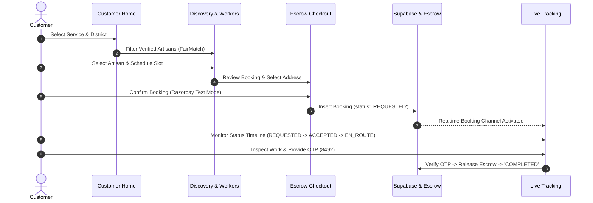
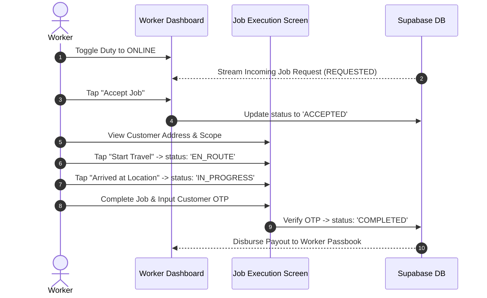

# 📐 ShramSetu — Master UI/UX Redesign Specification & Figma Blueprints

> **Role:** Senior Product Designer (Flutter Mobile, Responsive Web & Service Marketplaces)  
> **Platform:** Flutter Mobile (Android-first), Tablet & Responsive Desktop Web  
> **Domain:** Cooperative Gig-Worker Marketplace for India (Labour Cooperative Federations)  
> **Visual Source of Truth:** Dignified Modern Civic / Deep Teal & Warm Amber Palette  
> **Status:** Production-Ready Figma Blueprints & Flutter Implementation Architecture  

---

## Executive Summary & Design System Foundations

This specification redesigns **ShramSetu** to deliver an intuitive, trustworthy, and dignified marketplace connecting Indian residential/commercial customers with verified trade artisans (electricians, plumbers, carpenters, masons, painters) through certified district labour cooperative federations.

### Core Architecture Principles
1. **Dignified Modern Civic Aesthetics:** Deep Teal (`#0D5C5B`) for authoritative, accessible primary actions; Soft White (`#F8F9FA`) for clean canvas comfort; Warm Amber (`#D97706`) for restrained highlights, escrow milestones, and pending actions; Trust Green (`#16A34A`) for verified credentials and completed jobs.
2. **Dual-Signifier Accessibility (WCAG AAA):** Never rely on color alone. Every status, button, and indicator uses an explicit semantic icon, high-contrast text label, distinct bounding border, and screen-reader accessibility semantics.
3. **Multi-State Geographic Flexibility:** Dynamic federation routing supporting all Indian states, districts, and cooperative unions—never hardcoding Pune or any single region.
4. **State Machine Strictness:** Strict linear booking lifecycle (`REQUESTED` ➔ `ACCEPTED` ➔ `EN_ROUTE` ➔ `IN_PROGRESS` ➔ `COMPLETED` / `CANCELLED`) exposing **only valid contextual actions** per actor role.
5. **No Greenfield Destruction:** Existing production screens are preserved; refined components and layouts are introduced incrementally without breaking Supabase RLS policies, authentication gates, or the 327 passing automated tests.

---

## 🎨 Part 1: Figma Master Tokens & Component System

### 1.1 Color Tokens
```yaml
Global Tokens:
  primary: '#0D5C5B'          # Deep Teal (Primary CTA, top navigation, active tabs)
  on-primary: '#FFFFFF'       # Pure White on Primary
  primary-container: '#E0F2F1'# Soft Teal container
  on-primary-container: '#00363A' # Deep Teal ink

  secondary: '#D97706'        # Warm Amber / Golden Marigold (Pending, Escrow hold, Highlights)
  on-secondary: '#FFFFFF'
  secondary-container: '#FEF3C7' # Warm Amber tint
  on-secondary-container: '#78350F'

  success: '#16A34A'          # Trust Green (Verified artisan, Escrow released, Online)
  on-success: '#FFFFFF'
  success-container: '#DCFCE7'
  on-success-container: '#14532D'

  error: '#BA1A1A'            # Crimson (Rejection, Cancelled, Form error)
  error-container: '#FFDAD6'
  on-error-container: '#93000A'

  background: '#F8F9FA'       # Soft White Canvas
  surface: '#FFFFFF'          # Crisp White Card Surface
  surface-variant: '#F1F5F9'  # Cool Neutral Surface
  outline: '#64748B'          # Intermediate border / Secondary text
  outline-variant: '#CBD5E1'  # 1px Subtle Card & Input Border
  text-primary: '#0F172A'     # Slate-900 (High-contrast typography)
  text-secondary: '#475569'   # Slate-600 (Labels and descriptions)
```

### 1.2 Spacing Scale (8px Base Rhythm)
- `spacing-4xs`: 2px | `spacing-3xs`: 4px | `spacing-2xs`: 6px
- `spacing-xs`: 8px (Component internal gap)
- `spacing-sm`: 12px (Form row gap, compact card padding)
- `spacing-md`: 16px (Mobile outer margin, standard card padding)
- `spacing-lg`: 20px (Section gutters)
- `spacing-xl`: 24px (Tablet margin, desktop card interior)
- `spacing-2xl`: 32px (Desktop outer margin)
- `touch-target-min`: 48px × 48px (Mandatory touch clearance)

### 1.3 Typography System
- **Display & Headlines:** *Plus Jakarta Sans* (w700/w600). Generous counterforms for crisp readability under outdoor glare.
- **Body & Labels:** *Inter* (w400/w500/w600/w700). High x-height with 1.5× line height budgeting 30%+ horizontal expansion for Devanagari scripts (Marathi & Hindi).

### 1.4 Shape & Elevation Tokens
- `radius-sm`: 4px (Chips & micro-badges)
- `radius-md`: 8px (Input fields, secondary action buttons)
- `radius-lg`: 12px (Modal sheets, segment pickers)
- `radius-xl`: 16px (Operational cards, credential blocks)
- `radius-full`: 9999px (Status pills, avatar frames)
- `card-shadow`: `0 2px 6px -1px rgba(0, 0, 0, 0.04), 0 1px 3px 0 rgba(0, 0, 0, 0.02)`
- `elevated-shadow`: `0 10px 15px -3px rgba(13, 92, 91, 0.08), 0 4px 6px -2px rgba(0, 0, 0, 0.03)`

---

## 📱 Part 2: Specifications for 10 Prioritized Screens

### Screen 1: Customer Home & Service Discovery
- **Mobile Frame:** 390px × 844px | **Desktop Frame:** 1280px × 900px
- **Top Header:**
  - Dynamic Location Selector: Pin icon + `"Pune Cluster • Kothrud"` (tappable dropdown opening geographic federation switcher).
  - Multi-Lingual Switcher: `"अ/A मराठी / EN / हिंदी"`.
  - Notification Bell with unread badge.
- **Hero & Search:**
  - High-craft search bar (48px height): `"Search electrician, plumber, carpenter..."` with voice search and filter icon.
  - Active Booking Ambient Tracker: If user has an active booking (`EN_ROUTE` or `IN_PROGRESS`), a floating persistent pill appears: `"Partner en route • Arriving in 12 min →"` in Deep Teal with live pulse indicator.
- **Cooperative Welfare Guarantee Banner:**
  - Rounded card (16px) with Deep Teal accent: `"100% Zero Surge Standard Rates • Cooperative Escrow Protected • Police Verified Artisans"`.
- **Service Categories Grid:**
  - 4-column adaptive grid on mobile (Electrical, Plumbing, Carpentry, Painting, Cleaning, Appliance, Gardening, Masonry).
  - 8-column layout on tablet/desktop.
  - Tappable cards with subtle 1px border, dual-tone icon container, and localized title.
- **Recommended Nearby Artisans (FairMatch Showcase):**
  - Horizontal scroll cards on mobile, 3-column grid on desktop.
  - Artisan photo, name, verified federation badge, star rating (e.g. `4.9 ★ (128 jobs)`), base rate (e.g. `₹399`), and `"Book Now"` button.
- **Navigation:**
  - Mobile: Bottom Navigation (Home, Services, Bookings, Profile).
  - Desktop: Collapsible sidebar (260px expanded / 76px collapsed).

---

### Screen 2: Service Details & Worker Availability
- **Mobile Frame:** 390px × 844px | **Desktop Frame:** 1280px × 900px
- **Layout:**
  - Header with service category image/banner, standard union rate table, and transparent scope checklist.
  - Transparent pricing breakdown: Standard service fee, spare parts policy (at MRP with physical receipt), and ₹0 platform commission guarantee.
- **FairMatch Artisan Availability Engine:**
  - Filter by available time slots: Today (Morning, Afternoon, Evening) or Next 3 Days.
  - Artisan cards showing proximity (e.g. `"2.4 km away"`), primary trade certification, and verified cooperative federation name.
- **Sticky Bottom Action Bar (Mobile):**
  - Total standard fare (`₹399.00`) + `"Select Date & Time →"` in Deep Teal (`#0D5C5B`).

---

### Screen 3: Location & Address Selection
- **Mobile Frame:** 390px × 844px | **Modal Sheet:** 600px width (Desktop)
- **Top Bar:** GPS Auto-Detection Button: `"Use Current GPS Location"` with pulse animation.
- **Multi-State & District Cascading Selector:**
  - State Dropdown (e.g. Maharashtra, Karnataka, Gujarat, etc.).
  - District Dropdown (e.g. Pune, Mumbai, Nashik, Bengaluru, Ahmedabad).
  - Sub-locality / PIN Code input with instant serviceability check.
- **Serviceability Guard (`AreaNotServiceableScreen`):**
  - If no active federation operates in the entered PIN code, display clean informative fallback with district federation coverage map and `"Notify me when service launches"` email/phone register.
- **Customer Saved Addresses List:**
  - User-scoped addresses loaded from `addresses` table (Home, Work, Other).
  - Radio selection, default address badge, Edit/Delete icons, and prominent `"+ Add New Address"` button.

---

### Screen 4: Booking Review, Escrow Confirmation & History
- **Mobile Frame:** 390px × 844px | **Desktop Frame:** 1280px × 900px
- **Review Card Breakdown:**
  - Service item & scheduled time slot.
  - Selected delivery address with edit shortcut.
  - Assigned trade artisan (or `"FairMatch Auto-Assignment"`).
  - Transparent Price Breakdown: Service Base Wage + Union Welfare Cess (2%) + GST (if applicable).
  - Sovereign Escrow Guarantee notice: *"Funds held securely in escrow. Released to artisan only upon your 4-digit OTP confirmation after work satisfaction."*
- **Payment Method Selection:**
  - UPI (Google Pay, PhonePe, Paytm, BHIM).
  - Cards / NetBanking (Razorpay test mode).
  - Cash on Completion with Digital Invoice.
- **Booking History Tab View:**
  - Segmented toggle: `"Active Orders"` vs `"Past Orders"`.
  - Every card features [BookingStatusBadge](file:///c:/ShramSetu/app/lib/shared/widgets/booking_status_badge.dart) with distinct icon, text label, service title, date, artisan name, and order ID (`#SS-8492`).

---

### Screen 5: Live Booking Tracking with Status Timeline
- **Mobile Frame:** 390px × 844px | **Desktop Frame:** 1280px × 900px
- **5-State Linear Progress Stepper:**
  ```
  [1. Requested] ─── [2. Accepted] ─── [3. En Route] ─── [4. In Progress] ─── [5. Completed]
  ```
  - Active step highlighted in Deep Teal (`#0D5C5B`) with pulsing ring.
  - Completed steps in Trust Green (`#16A34A`) with check icon.
  - Future steps in muted outline (`#CBD5E1`).
- **Interactive Live Map Container:**
  - Simulated GPS breadcrumb route from artisan location to customer address.
  - Estimated arrival time countdown badge (e.g. `"Arriving in 14 mins"`).
- **Artisan Dossier Card:**
  - Verified photo, full name, trade badge, phone call button (masked connection), and in-app chat trigger.
- **Sovereign Escrow OTP Card:**
  - Prominent high-contrast card: `"Work Completion OTP: 8492"`.
  - Clear customer guidance: *"Share this code with the artisan ONLY after they complete the work to release escrow funds."*
- **Contextual Actions:**
  - `"Cancel Booking"` (available only during `REQUESTED` and `ACCEPTED` before dispatch).
  - `"Emergency Helpdesk SOS"` button permanently accessible.

---

### Screen 6: Worker Dashboard (Today's Jobs & Requests)
- **Mobile Frame:** 390px × 844px | **Desktop Frame:** 1280px × 900px
- **Duty Toggle Header:**
  - Prominent pill switch: `[OFFLINE] <═══> [ONLINE]`.
  - When Online: Trust Green pulse, text `"Available for instant dispatch in Kothrud, Pune"`.
  - Quick Payout Banner: Today's released escrow earnings (`₹1,240`), completed jobs count (`3`), and active rating (`4.9 ★`).
- **Emergency / Broadcast Dispatch Alert:**
  - Red/Amber banner when high-priority civic or union emergency requests exist.
- **Incoming Job Request Card (High-Priority Realtime Stream):**
  - Service title: `"Emergency Switchboard Sparking"` (Electrical).
  - Customer distance: `"1.8 km (Bhusari Colony)"`.
  - Payout amount: `"₹499.00 (Escrow Funded)"`.
  - Expiry countdown progress bar (45 seconds).
  - Dual action buttons: `[Pass to Guild]` (Neutral outlined) and `[Accept Job]` (Solid Deep Teal).
- **Today's Active Schedule:**
  - Chronological list of accepted jobs with time slot, customer address, and quick `"Navigate with Maps"` button.
  - Zero-state: Clean verified empty state (`AppEmptyView`) when no jobs remain today.

---

### Screen 7: Worker Booking Details with Contextual Action Gate
- **Mobile Frame:** 390px × 844px
- **Strict Contextual State Machine (Only Valid Actions Shown):**
  1. **State = `REQUESTED`:**
     - Actions: `[Reject / Pass to Guild]` | `[Accept Job]`
  2. **State = `ACCEPTED`:**
     - Actions: `[Call Customer]` | `[Start Travel (En Route) →]`
  3. **State = `EN_ROUTE`:**
     - Actions: `[Open Google Maps Navigation]` | `[I Have Arrived at Location →]`
  4. **State = `ARRIVED`:**
     - Actions: `[Inspect Scope]` | `[Start Work (In Progress) →]`
  5. **State = `IN_PROGRESS`:**
     - Hardware Parts Ledger: Ability to add purchased materials with bill image.
     - Completion Gate: 4-digit OTP input field. Worker inputs the OTP provided by the customer.
     - Action: `[Verify OTP & Complete Job →]`
  6. **State = `COMPLETED`:**
     - Displays: Trust Green settlement stamp, breakdown of payout disbursed to union passbook, customer rating feedback.

---

### Screen 8: Federation Admin Operational Dashboard
- **Desktop Primary:** 1280px × 900px | **Responsive Tablet:** 768px × 1024px
- **Federation Jurisdiction Selector:**
  - Shows assigned cooperative UUID (e.g. `"Pune District Labour Cooperative Federation #12"`).
  - State & District jurisdiction breadcrumb.
- **Key Operational Metrics (KPIs):**
  - Active Verified Artisans (e.g. `248`).
  - Pending Verification Applications (`14` in queue with alert pill).
  - Active Bookings Today (`67`).
  - Escrow Volume Settled (`₹2,48,500`).
  - Open Member Disputes (`1`).
- **Artisan Verification Queue:**
  - Table view: Artisan Name, Trade, Mobile, Govt KYC ID, Trade Certificate, Registered Date, Review Action.
  - Status indicators: `PENDING`, `UNDER_REVIEW`, `CHANGES_REQUIRED`, `APPROVED`, `REJECTED`.
- **Live Dispatch Oversight Table:**
  - Real-time booking monitor across the district with FairMatch explainability score (distance weight, artisan idle time, skill fit).
- **Complaints & Dispute Resolution Desk:**
  - Customer/Worker mediation portal with escrow freeze and release authority.

---

### Screen 9: Worker Registration & 20-Field Verification Gate
- **Mobile Frame:** 390px × 844px
- **4-Step Stepper Progress Bar:**
  1. **Step 1: Personal & Geographic Identity** (Full name, phone, DOB, gender, home address, district, state, PIN code).
  2. **Step 2: Trade & Craft Qualifications** (Primary trade, skill level, years of experience, service areas).
  3. **Step 3: Cooperative Affiliation** (Federation name, cooperative membership ID / union card number).
  4. **Step 4: Document Verification Upload** (Aadhaar / Voter ID photo, trade competency certificate, selfie photo).
- **Under Verification Waiting Screen (`WorkerUnderVerificationScreen`):**
  - Lock illustration with pulse.
  - Clear explanatory message: *"Your application is being reviewed by the Pune District Labour Cooperative Federation. You will be activated within 24 hours."*
  - Realtime Supabase status listener: Automatically transitions to `WorkerDashboardScreen` once admin approves.
  - Rejection State: Displays admin's exact rejection remarks + prominent `"Correct & Reapply"` button pre-filling previous entries.
  - Prominent Sign Out button allowing workers to switch accounts.

---

### Screen 10: Unified Reusable State System
- **Loading State ([AppLoadingView](file:///c:/ShramSetu/app/lib/shared/widgets/state_views.dart)):**
  - Deep Teal circular spinner, branded icon, and contextual text (`"Loading active bookings..."`).
- **Empty State ([AppEmptyView](file:///c:/ShramSetu/app/lib/shared/widgets/state_views.dart)):**
  - Soft neutral circular container with relevant icon (`Icons.inventory_2_outlined`).
  - Localized title (`"No active orders in progress"`), informative explanation, and Deep Teal CTA button (`"Book a Service"`).
- **Error State ([AppErrorView](file:///c:/ShramSetu/app/lib/shared/widgets/state_views.dart)):**
  - Crimson card with subtle border, error diagnostics, and prominent `"Try Again"` retry button with `onRetry` callback.
- **Offline State ([AppOfflineView](file:///c:/ShramSetu/app/lib/shared/widgets/state_views.dart)):**
  - Warm Amber card with `Icons.wifi_off_rounded`, network troubleshooting guidance, and `"Retry Connection"` callback.
- **Success Toast / Modal:**
  - Trust Green pill animation with checkmark and tactile haptic feedback on action completion.

---

## 🗺️ Part 3: Interactive User Journey Maps

### 3.1 Customer Booking Journey


### 3.2 Worker Dispatch & Job Execution Journey


---

## 💻 Part 4: Implementation & File Mapping Matrix

| Screen / Component | Existing File | Proposed Refinement Strategy |
| :--- | :--- | :--- |
| **Color Tokens** | [app_colors.dart](file:///c:/ShramSetu/app/lib/core/theme/app_colors.dart) | ✅ Canonical `deepTeal` (`#0D5C5B`), `softWhite` (`#F8F9FA`), `warmAmber` (`#D97706`), `successGreen` (`#16A34A`) established. |
| **Status Badges** | [booking_status_badge.dart](file:///c:/ShramSetu/app/lib/shared/widgets/booking_status_badge.dart) | ✅ Dedicated accessible badge with semantic icons + text labels + borders. |
| **Responsive Layout** | [customer_main_layout.dart](file:///c:/ShramSetu/app/lib/features/customer/presentation/screens/customer_main_layout.dart) | ✅ Mobile bottom nav + desktop smoothly collapsible animated sidebar (76px/260px). |
| **State Views** | [state_views.dart](file:///c:/ShramSetu/app/lib/shared/widgets/state_views.dart) | ✅ Reusable `AppLoadingView`, `AppEmptyView`, `AppErrorView`, `AppOfflineView`. |
| **Customer Home** | [customer_home_screen.dart](file:///c:/ShramSetu/app/lib/features/customer/presentation/screens/customer_home_screen.dart) | Incorporate `BookingStatusBadge` ambient tracker & Deep Teal action buttons. |
| **Customer Discovery** | [worker_discovery_screen.dart](file:///c:/ShramSetu/app/lib/features/customer/presentation/screens/worker_discovery_screen.dart) | Standardize artisan card borders and multi-district selector. |
| **Booking Details** | [booking_details_screen.dart](file:///c:/ShramSetu/app/lib/features/booking/presentation/screens/booking_details_screen.dart) | Razorpay test mode preserved; Deep Teal CTA and address selector. |
| **Live Tracking** | [customer_live_tracking_screen.dart](file:///c:/ShramSetu/app/lib/features/customer/presentation/screens/customer_live_tracking_screen.dart) | 5-state linear stepper with OTP security card and real-time channel. |
| **Worker Dashboard** | [worker_dashboard_screen.dart](file:///c:/ShramSetu/app/lib/features/worker/presentation/screens/worker_dashboard_screen.dart) | Duty toggle switch, incoming request countdown card, and real earnings passbook. |
| **Worker Job Detail** | [worker_job_detail_screen.dart](file:///c:/ShramSetu/app/lib/features/worker/presentation/screens/worker_job_detail_screen.dart) | Linear contextual action gate showing only valid actions per state. |
| **Admin Dashboard** | [admin_dashboard_screen.dart](file:///c:/ShramSetu/app/lib/features/admin/presentation/screens/admin_dashboard_screen.dart) | District federation KPI cards, artisan verification queue, dispute resolution. |

---

## 🔒 Security, RLS & Business Logic Preservation

1. **No Mock Fallback in Production:** Real database queries strictly bound to Supabase PostgreSQL 15.
2. **Row Level Security (RLS):** All data fetching uses authenticated customer UUIDs, worker UUIDs, or federation admin UUIDs.
3. **Secrets Safeguard:** Zero API keys, private credentials, or Supabase service roles exposed in frontend code.
4. **Razorpay Guard:** Remained strictly in test mode (`rzp_test_...`) with test key credentials.
5. **No Screen Destruction:** All current screens remain operational while revisions are verified against the automated test suite.
